# SfUi — Salesforce CLI Launcher

A desktop tool for Windows and macOS that wraps the Salesforce CLI (`sf`) with a fast, click-light UI.
Run SOQL, anonymous Apex, debug logs, deploys, free-form `sf` commands and raw REST API calls —
with history/favorites, an **explorable REST tree** that fills request parameters for you, quick switching between orgs and project folders, one-click tool launcher,
an **Org Info** window for each org (with one-click **definition-document export** to Excel / CSV), side-by-side comparison of 2–4 orgs, **record backup / restore** with backup-to-backup comparison,
and an **Org Management** window that keeps your orgs in order (default, alias, login, register, logout) and shows per-org limits and a workflow/flow migration inventory.

> UI languages: **English (default) / 日本語 / 简体中文 / 한국어** — switch instantly from the top bar.

📖 **User manual**: [English](docs/manual/en.md) · [日本語](docs/manual/ja.md) · [简体中文](docs/manual/zh.md) · [한국어](docs/manual/ko.md) — setup, every window explained, screenshots and diagrams.

## Getting started

Two ways to get going: use a prebuilt binary below, or [build from source](#build-from-source).

### Windows (prebuilt)

1. **Microsoft Store (recommended):** install from [SfUi on the Microsoft Store](https://apps.microsoft.com/store/detail/9NX0BFFHF7B1) — signed by Microsoft, so there is no SmartScreen warning (the Store version may lag a little behind the GitHub builds).
2. **Or download from the [Releases](../../releases) page:**
   - **`SfUi.exe`** — the portable single executable, or
  - **`SfUi-v0.24.1-portable.zip`** — the executable **plus a ready-to-use `data/` folder with 30 sample SOQL / Apex / commands / REST requests already in the history** (just extract and run).
  - **`SfUi-0.24.1-x64.msix`** — Windows installer (MSIX). Trust the bundled certificate first: double-click **`SfUi-0.24.1-x64.cer`** → *Install Certificate* → **Local Machine** → **Trusted People** (admin required), then double-click the `.msix` to install.
3. Put it in any folder and double-click (no installer).
   - Windows SmartScreen may warn on the GitHub builds because the executable is unsigned (the Store version is signed) — choose *More info* → *Run anyway*.
4. On first run a `data/` folder is created next to the exe (portable mode). Pick your org in the top bar and start with a tab — or add the sample history via **Settings → Seed sample history**.

### macOS (Apple Silicon, prebuilt)

1. Download **`SfUi-0.24.1-osx-arm64.zip`** from [Releases](../../releases), extract it and run `SfUi.app`.
2. The app is signed with a Developer ID certificate and **notarized by Apple**, so it opens with a normal double-click — including the very first launch.
3. Same as Windows from there: pick your org in the top bar and start with a tab.

> Both need the **Salesforce CLI (`sf`)** installed and at least one authenticated org (`sf org login web`) — see [Requirements](#requirements).

## Build from source

The build only needs the **free .NET SDK 9.0+** ([dotnet.microsoft.com](https://dotnet.microsoft.com/download)) — no paid Visual Studio is required. With the SDK installed, the `dotnet` CLI alone covers building, running, testing and producing the distributable EXE. There is no `global.json`, so any 9.0+ SDK works.

```bash
git clone https://github.com/huqian2016/SfUi.git
cd SfUi
```

### Windows (WPF app)

```powershell
# Build everything + run the tests
dotnet build SfUi.sln -c Debug
dotnet test  SfUi.sln

# Run the WPF app from source
dotnet run --project src/SfUi.App

# Produce a self-contained single-file EXE into dist/
dotnet publish src/SfUi.App/SfUi.App.csproj -c Release -r win-x64 `
  --self-contained true -p:PublishSingleFile=true -p:IncludeNativeLibrariesForSelfExtract=true -o dist
```

The Avalonia shell below also runs on Windows: `dotnet run --project src/SfUi.Avalonia`.

### macOS (Avalonia app)

```bash
# Run the Avalonia shell
dotnet run --project src/SfUi.Avalonia

# Build SfUi.app + distributable zip into dist/mac/
bash packaging/make-mac-app.sh osx-arm64   # or osx-x64
```

`src/SfUi.Avalonia` is an Avalonia 11 port that shares all logic through `SfUi.Core` + `SfUi.Presentation` (UI-framework-free ViewModels), so the same source builds and runs on Windows and macOS. The prebuilt macOS app (`SfUi.app`, Apple Silicon) is attached to each [release](../../releases) — it is assembled and smoke-tested (launch / language switch / exit 0) on real macOS runners in CI.

### Project layout

```
SfUi.sln
├─ src/SfUi.Core    … WPF-free logic (services, stores, localization dictionaries, tests target)
│  ├─ Services      … SfCliRunner, OrgService, SalesforceRestClient, DeployService, ToolLauncherService, …
│  ├─ Storage       … atomic JSON stores (settings / history / favorites / recent)
│  └─ Localization  … UiText dictionaries (en / ja / zh / ko)
├─ src/SfUi.Presentation … UI-framework-free ViewModels + UI abstractions (shared by WPF and Avalonia)
├─ src/SfUi.App     … WPF app (Windows; MVVM, views, localization markup extension)
├─ src/SfUi.Avalonia … Avalonia 11 app (Windows / macOS; shares Core + Presentation)
└─ tests/SfUi.Tests … xUnit (1212 tests: quoting, JSON parsing, stores, services, org info & document export, org compare, data I/O, backups, org management, scratch orgs (incl. shapes, snapshots, Experience Cloud / Named Credential presets), source editor (incl. flow graph parser, completion engines, AI snippets and local history), ETL (staging / engine / delta / verification / job files / expressions), SOQL editing (Id injection / edit planner / result grid model / multi-statement scripts / result panes), REST catalog (tree metadata / path & body expansion), metadata cache, ER diagrams, localization, …)
```

Built with C# / .NET 9, CommunityToolkit.Mvvm and AvalonEdit (WPF) / AvaloniaEdit (Avalonia). All business logic is shared through `SfUi.Core` and `SfUi.Presentation`, so fixes apply to both UIs at once.

## Screenshots

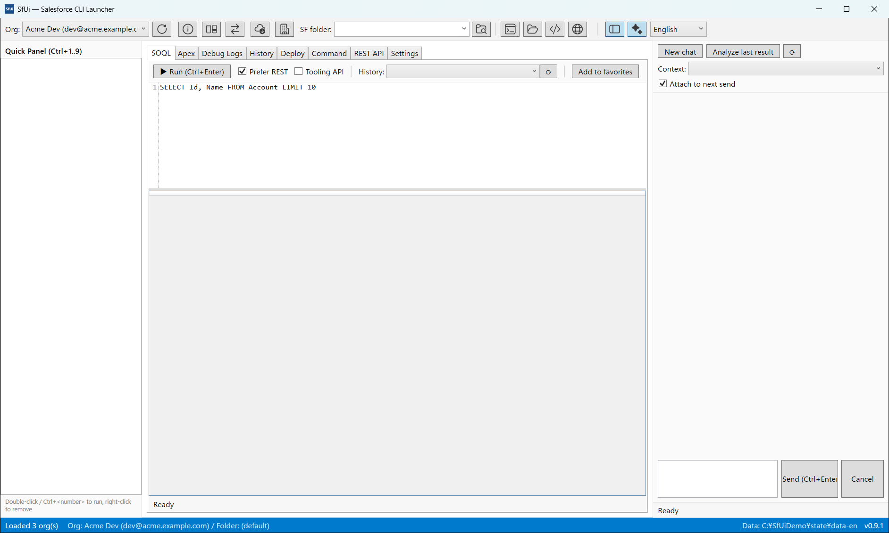
*SOQL workspace — Quick Panel on the left, AI chat panel on the right, icon tool bar with org & folder switching on top*

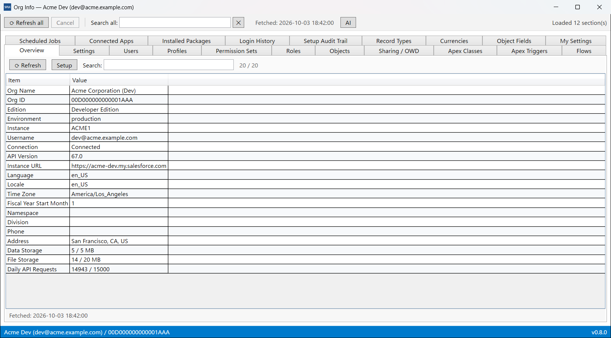
*Org Info — a separate window per org with 20+ tabs, cross-tab search, Setup links and its own AI panel*


*Org Info → Export — pick objects and documents (objects / fields / page layouts / list views / flows) and write a multi-sheet Excel workbook plus one CSV per sheet*

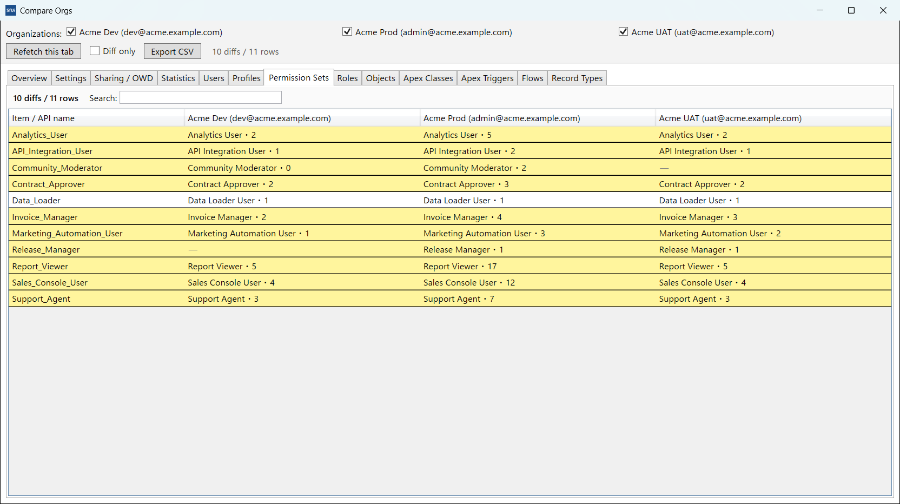
*Compare Orgs — compare up to 8 orgs side by side; rows that exist in only some orgs (or differ in value) are highlighted in yellow*

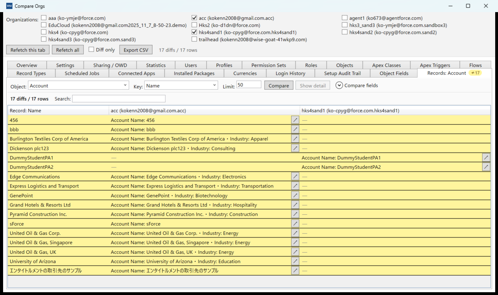
*Compare Orgs → record compare tab — pick an object, a matching key and the fields to compare; each org is queried with REST SOQL and records are matched by key*

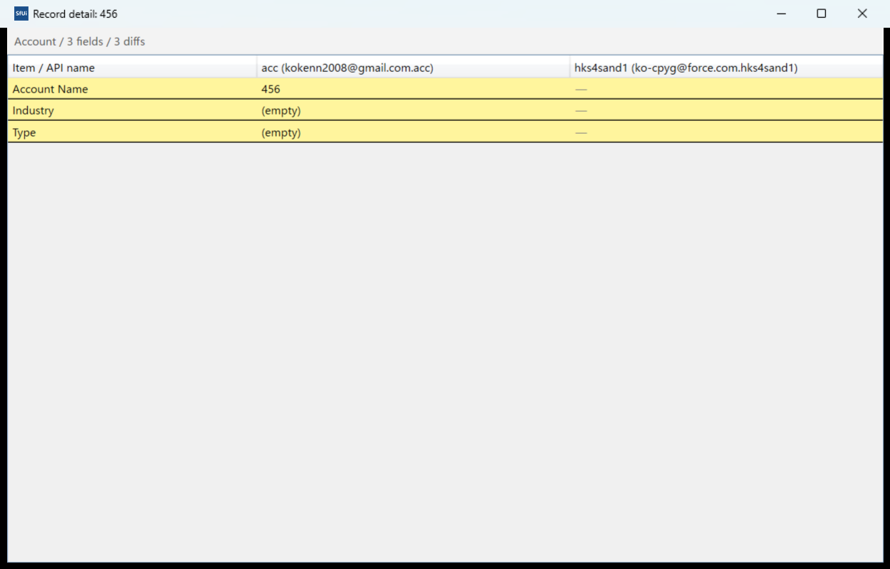
*Record detail window — double-click a row to see the per-field diff of one record across orgs*

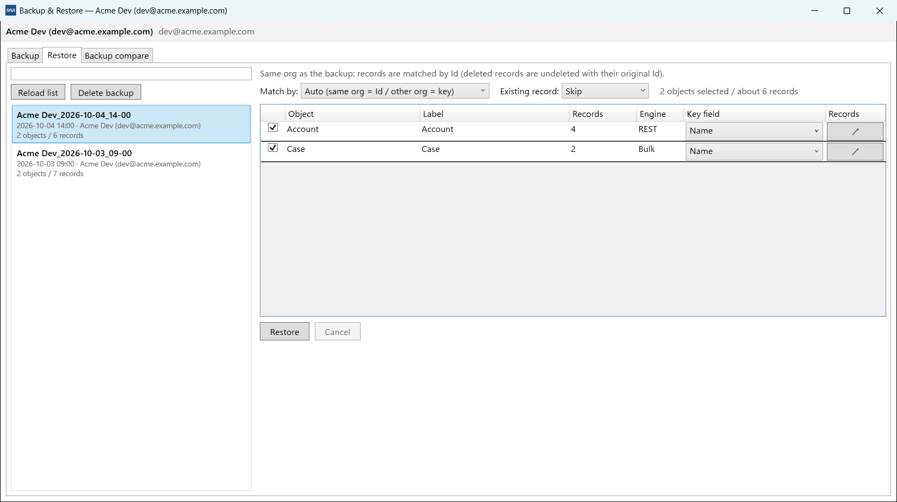
*Backup & Restore — pick a backup and restore objects with Id/key matching; label, description, org info and counts are filled in for you*

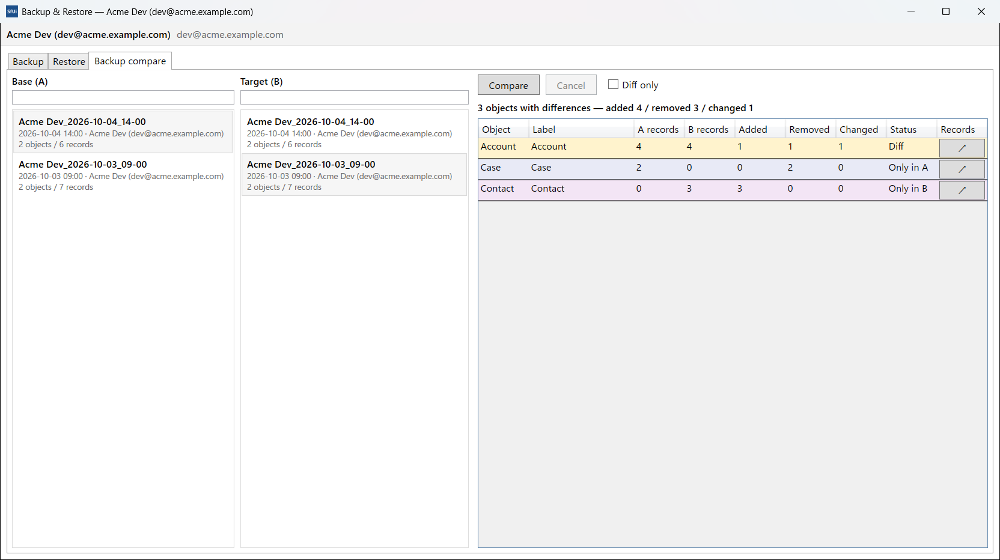
*Backup compare — objects with differences are highlighted by color (diff / only in A / only in B); record-level diffs open in a separate window*

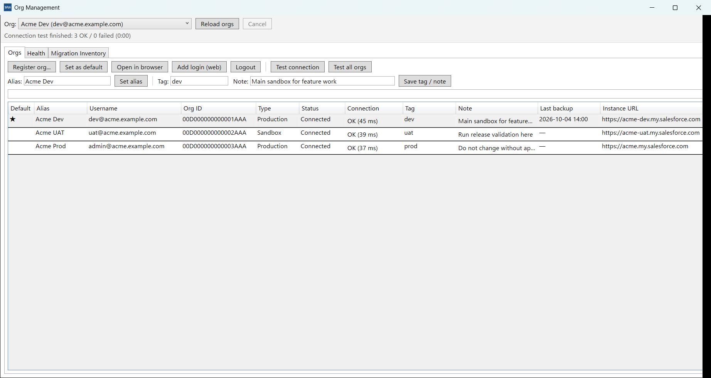
*Org Management — every authenticated org with local tags / notes, connection tests, last backup and one-click default / alias / login / logout*

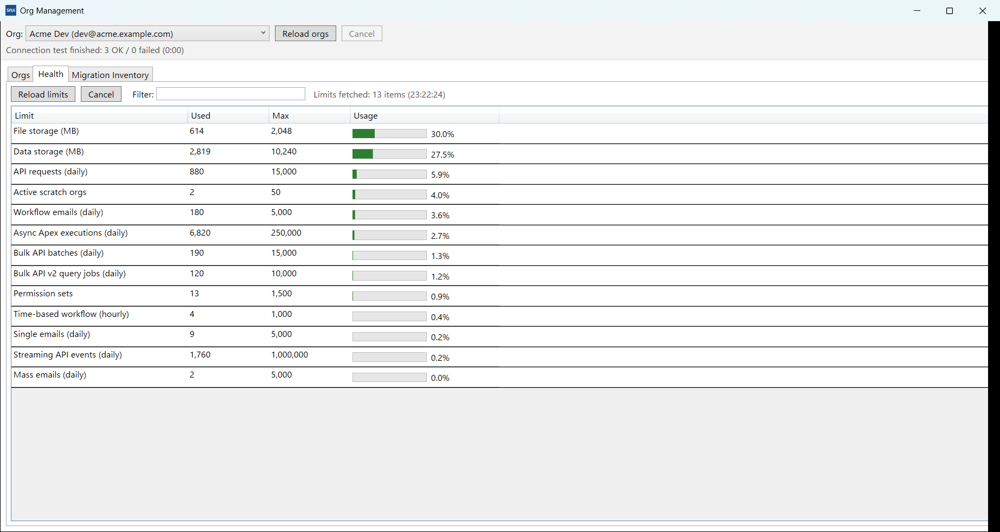
*Org health — REST limits with usage bars (red at 80%+), sorted by usage and filterable by name*

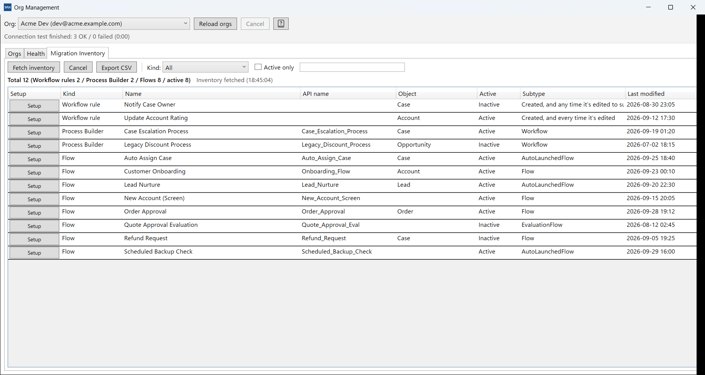
*Migration inventory — workflow rules (active state read from their metadata), Process Builder processes and flows with kind / active filters, CSV export and Setup links*

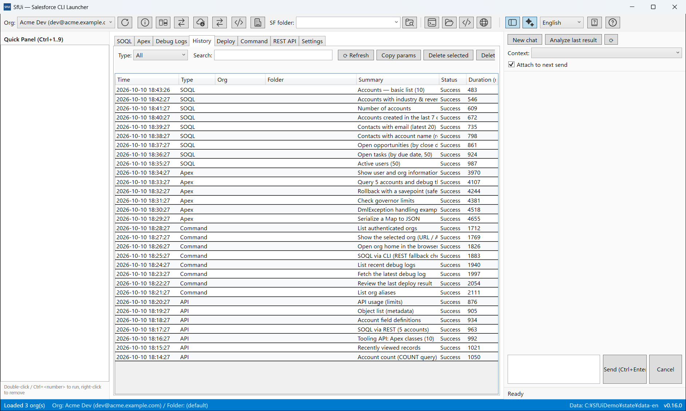
*Every operation is saved in History and can be replayed with a double-click*

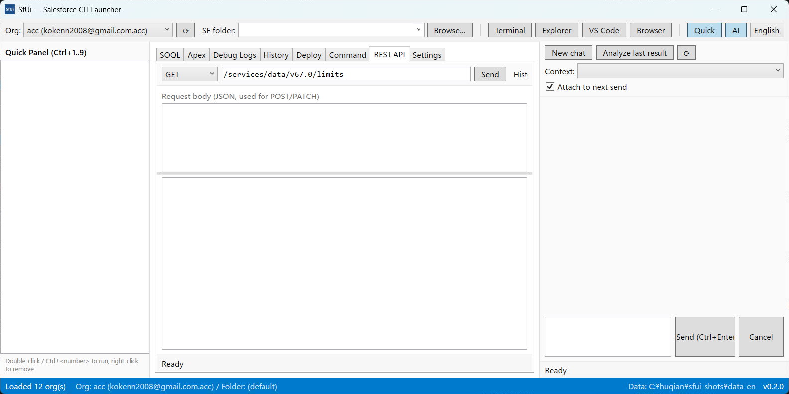
*REST console — the tree on the left fills the method, path and parameters for you*

## Features

- **Org & folder switching in one click** — the org combo and SF folder combo are always in the top bar; the last selection is restored on startup.
- **Fast startup** — the org list is cached in `data/orgs-cache.json` and restored **instantly** at launch, then refreshed **in the background** with a low-priority CLI process (the UI never waits for it; manual refresh takes priority and cancels it). The selected org's access token is prefetched in the background, and concurrent token requests are coalesced, so the **first SOQL run after launch** no longer pays the CLI startup cost.
- **Instant completions** — the metadata behind the suggestion chips (sObject list, per-object describes, Apex classes, custom metadata types and labels) is cached per org under `data/metadata-cache/` and restored **instantly** at launch. The cache is verified **in the background** and only rewritten when the org's metadata actually changed; the selected org's metadata is warmed in the background as soon as the org is chosen (measured: first suggestion 9.7 s → 6 ms once the cache is warm).
- **Welcome screen** — shown at every startup until you tick *Don't show this again*: highlights the main features, checks that Salesforce CLI (`sf`) is installed (installer link, `npm` hint and a **Re-check** button when it is missing), offers *Get started* / *Open settings* buttons and lets you switch the UI language on the spot. Reopen it anytime from Settings.
- **Multiple tabs for SOQL / Apex / Command** — press **＋** at the right end of the sub-tab strip to add another tab (and **×** to close it); every tab keeps its own editor text, results, output and running state, so several queries, scripts or commands can run side by side. Open tabs and their contents are saved automatically and restored on the next launch. Sub-tabs can be **renamed** (✎ — an empty name restores the default numbering) and **duplicated** (⧉ — same query text, name suffixed with *(copy)*, inserted right after the source); custom names survive reordering and are restored on the next launch.
- **SOQL scripts (multi-statement)** — separate statements with `;` to run them top to bottom; every statement gets its **own result pane** (up to 20) stacked vertically in a scrollable area, and each pane has a **filter box** that narrows just that result (visible / total rows, Id and every cell are searched). `--` line comments and `/* … */` block comments are stripped before execution. A single statement keeps the classic single grid. Completions follow the **statement under the cursor**, so the second statement suggests its own object's fields. **Copy results / Export report / Export CSV work per statement** (the clipboard and the report get one titled table per statement, CSV writes `<name>-1.csv`, `-2.csv`, …), and cells or rows selected in any pane can be copied with `Ctrl+C` (header row included).
- **SOQL** — AvalonEdit editor with SQL highlighting and an inline **suggestion area** (fields, relationships and functions as clickable chips — clicking a SELECT field also inserts `, ` so you can keep clicking the next fields), REST-first execution (falls back to `sf data query`, with a Tooling API toggle), a live row count, results in a sortable grid with a **fixed leading Id column** (auto-added when the query does not select Id; click the Id to open the record page in Lightning) and **inline cell editing** — system / relationship fields stay read-only, pending edits are highlighted in yellow (deploy errors in red) and pushed back with the **Deploy to org (n)** button (REST composite / Tooling API), CSV/TSV export, and an AI assist that sends the run result (candidate queries + *Open in SOQL*). **Results are cached per org** (`data/soql-cache/`): running the same query again shows the previous result instantly with a **“Cached · 12:34” badge** in the status bar, then refreshes it in the background and removes the badge as soon as the fresh rows arrive (a failed refresh keeps the cached rows and says so). Editing records in the grid invalidates that query's cache.
- **Anonymous Apex** — run scripts via `sf apex run`, show compile errors / exceptions / debug logs, open & save `.apex` files, fetch the latest debug log from the org. The editor offers **completion** (snippets, static members, inline SOQL, sObject names / fields / relationships, variables & collections, org Apex classes, `System.Label.*` and custom metadata types), and after a run an AI assist can answer automatically (errors) or suggest the next lines (*AI: continue code*).
- **Debug logs** — list logs (`sf apex list log`), fetch content by id or number, save locally.
- **Deploy** — deploy / validate / quick deploy / report / retrieve with source dir or manifest, test level, wait time, live command preview, and result summaries (auto-fills the job id).
- **Free-form commands** — run any `sf` arguments; dangerous operations (delete/logout/deploy …) ask for confirmation.
- **REST console with a REST tree** — GET/POST/PATCH/DELETE against the org's instance URL using the access token (`sf org display`, with an automatic `sf org auth show-access-token` fallback on CLI versions that redact it), with pretty-printed responses and 401 auto-refresh. The left panel is an expandable **REST tree**: favorites and recent requests first, then grouped endpoints (system: versions / limits / theme / recently viewed / query / search; tooling; composite; quick actions; UI API; Bulk API), a **Custom APIs** group (the org's custom actions from `/actions/custom` — one click each — plus Apex REST `/services/apexrest` request templates with a `urlMapping` field) and an **SObjects** folder that lazily lists every object by first letter, each with its standard requests (get records / get by Id / create / update / delete / describe / layouts / list views). Selecting an endpoint fills the method, the path (API version substituted live) and the body template, and shows only the **parameters that endpoint needs** as dedicated fields — typing an Id rewrites the path immediately. The request bar follows Workbench's **REST Explorer**: method buttons (GET / POST / PATCH / DELETE), the full path with the resolved **absolute URL** underneath, an **Execute** button, and a *Show raw response* toggle over the response pane. The object list is loaded once per org in the background (the window never blocks), a filter box searches all requests and object names, and a missing required parameter is caught before the request is sent.
- **Report export on every data tab** — each tab has an **Export** button that opens a settings dialog (formats, analysis, row limit, output folder, open when done) and writes any combination of **CSV**, **Markdown (for AI — YAML front matter + tables)**, **HTML (self-contained, filter every column / click a header to sort / print)**, **Excel (multi-sheet with a summary sheet)** and **PDF**. An optional analysis section adds row/column counts, empty cells, numeric totals / average / min / max, distinct values with the top 5, constant columns and duplicate row groups. Wired into SOQL results, History, Debug logs, Anonymous Apex, Command output, the REST console, and the org info, org compare, data I/O, backup & restore, ETL, source editor, org management and scratch org windows. **The dialog remembers your last settings** (formats, analysis, row limit, output folder, open-after-save) and restores them on the next launch.
- **Editable ER diagrams** — from **Org Info → Objects** and **Data I/O**, pick objects (search + select), choose how names are shown (**label / API name / label + API name**) and export: **Mermaid** (.md + .mmd), **DBML**, **draw.io** (.drawio), **PlantUML**, **Graphviz DOT**, a **self-contained HTML page** (inline SVG diagram + searchable relationship / object tables + print to PDF), plus images (**SVG / PNG / JPEG / WebP**, generated locally with SkiaSharp). Diagrams use a **radial layout** — the most connected object sits in the middle and its neighbours form outer rings, with the rings expanded until nothing overlaps. Relationships come from Tooling API `FieldDefinition` (lookup / master-detail, polymorphic references, self references), system objects are excluded, and referenced parents can be pulled in automatically. The dialog remembers your last settings (formats, name style, options, output folder) across restarts.
- **History** — every operation is recorded per type (org, folder, params, result), searchable, re-runnable by double-click.
- **Favorites & quick panel** — pin SOQL / Apex / commands / REST requests / URLs / folders; run the first nine with `Ctrl+1..9`. The panel starts **hidden** (toggle it with the *Quick* button in the top bar).
- **AI chat (multi-provider)** — generate SOQL / Apex / sf commands from natural language and analyze execution results; apply generated code to the matching tab with one click. Shown in a right-side panel (toggle with the **AI** button in the top bar). Works out of the box — an evaluation API key for the default DeepSeek endpoint is bundled. Settings → AI offers presets for **OpenAI-compatible APIs** (OpenAI, Anthropic via its OpenAI-compatibility layer, or a local LLM such as Ollama / LM Studio — no key needed there); set your own key in Settings → AI (or via the `SFUI_AI_API_KEY` environment variable). The bundled evaluation key is provided as-is **with usage limits** and may stop without notice — register your own key for uninterrupted use.
- **Org Info window** — a separate non-modal window per org (click **Org Info** next to the org combo) with 20+ tabs: overview, org settings (values + setup links), users, profiles, permission sets, roles, objects, sharing/OWD, Apex classes & triggers, flows, scheduled jobs, connected apps, installed packages, login history, setup audit trail, record types, currencies, object fields (lazy-loaded) and your own **My Settings** tabs built from a 55-item catalog. Search across all tabs, refresh per tab or all at once, jump straight to Setup pages. Data is cached locally and fetched only on first open (manual refresh after that), so reopening is instant — and each window has its own AI panel with *Attach current tab data* + quick prompts.
- **Definition-document export (Org Info → Export tab)** — turn org metadata into definition documents: pick objects (filter / custom-only / select all), tick **object definitions, field definitions, page layouts (section × column × row with required / read-only flags), list views (scope, conditions, columns with sort order, full SOQL) and flows (summary + element-level detail with connectors and conditions)**, then export **one multi-sheet Excel workbook + one CSV per sheet** (Excel / CSV toggles). Live progress, cancel, partial-failure warnings and an *Open folder* button; the object list is cached and refreshable in one click. Works in both the WPF and the Avalonia (macOS) app.
- **Org comparison** — open the **Compare Orgs** window from the top bar and compare **up to 8 orgs** side by side: org settings, OWD, counts, users, profiles, permission sets, roles, objects, Apex classes/triggers, flows, record types, scheduled jobs, connected apps, installed packages, currencies, login history and setup audit trail are matched **by API name**, with rows that exist in only some orgs (or differ in value) highlighted. Every cell has a ↗ link to the matching Setup page, tabs show diff-count badges (≠N) and *Refetch all* reloads every tab. Two dynamic tabs go further: **Object Fields** (pick any object and compare its field metadata) and **Record compare** (pick an object, a matching key such as Name and the fields to compare — each org is queried with REST SOQL and records are matched by key; double-click a row to open the per-field **detail window**). Includes a *Diff only* filter, cache-first loading (shared with the Org Info window — missing sections are fetched automatically) and CSV export.
- **Debug log analyzer** — from the Log tab click **Analyze** to parse the log you are viewing, or open any local `.log` file from disk: summary cards (total time, event counts, SOQL/DML rows, callouts, exceptions), governor limits with usage bars, the slowest events, an execution **tree** with per-node durations, and a searchable / filterable **event list** with CSV export. Parsing is offline and safe (unknown lines are kept, never dropped).
- **Field usage (impact analysis)** — wondering *"what breaks if I delete this field?"* Open **Org Info → Object Fields**, select a field and click **Find field usage**: SfUi scans Apex classes/triggers, flows, validation rules, page layouts, formula fields and field permissions, showing component, line / JSON path, an excerpt and a double-click link to Salesforce — with a source filter (e.g. *Field permissions*) and CSV export.
- **Data Import / Export window** — a separate window (open from **Data I/O** in the top bar, or from the **Data I/O** button on the Objects tab of the Org Info window, which pre-fills the selected object) with two tabs. *Export*: run SOQL directly or build it from field checkboxes, via REST or Bulk API, browse the result grid and save as CSV / JSON / TSV. *Import*: load a CSV (UTF-8 / Shift-JIS auto-detected), auto-map columns to fields (editable, with per-column include toggles), and run Insert / Update / Upsert / Delete via REST (`composite/sobjects`, 200 records per batch) or Bulk API — with a confirmation prompt, live progress and a per-row result grid (export failed rows to CSV). Runs are recorded in History as `data` and re-run by double-click.
- **Access tabs** — the same window also has three access-permission tabs for the selected object. **Object Access**: object permissions of Permission Sets / Permission Set Groups / Profiles (kind, label, API name, custom, Read / Create / Edit / Delete / View All Records / Modify All Records / View All Fields, with row search; PSG rows are the union of their component permission sets). **Field Access**: a field × subject matrix (cells R / E) with kind filters, row search and column search. **Record Access**: pick active users with checkboxes (name search, scrollable) and run any SOQL to fetch target records, then page 200 at a time with search and see per-user **Read / Edit / Delete / Transfer** via `UserRecordAccess`, with links to open each record. **User Access** (new): select one or more active users (checkbox list with search and select all/clear) and press *Show effective access* to see, for the selected object, the union of each user's profile + assigned permission sets / permission set groups — object-level flags (Read / Create / Edit / Delete / View All / Modify All / View All Fields) and a field × user table (✓/— for Read / Edit with the granting subjects), plus field search, an *edit only* filter and CSV export for both tables.
- **Backup & Restore window** — a separate window (open from **Backup & Restore** in the top bar) with three tabs. *Backup*: pick objects from a searchable list with record counts (fetched in the background and cached — refresh anytime); the selection is remembered per org and can be cleared with one button; the label/description are prefilled with `<alias>_yyyy-MM-dd_HH-mm` and the alias, URL, org ID and org type, and the run exports small objects via REST, larger ones via Bulk API (CSV). *Restore*: choose a backup from the searchable list (with delete), pick target objects (record counts, per-object key field, and a **Records** button that opens a detail window with paging, AND search and a leading column to open each record's Salesforce page), then restore. **Same org**: records are matched by Id (existing records are skipped or overwritten, deleted records are undeleted **with their original Id**); **another org**: matched by a key field such as Name. Inserted records get new Ids and lookups to them are remapped automatically. A result grid summarizes created / updated / undeleted / skipped / failed per object.
- **Backup compare tab** — the same window compares two backups: pick a base (A) and a target (B), and every object is matched record by record (by Id; values are normalized across REST JSON and Bulk CSV). Objects with differences are highlighted by color (diff / only in A / only in B / error) with an optional *Diff only* filter, and the ↗ button opens a separate window with the record-level result (kind, Id, name and `Field: A → B` changes; searchable, paged, and with a leading column to open each record's Salesforce page).
- **Org Management window** — a separate window (open from **Org Management** in the top bar) with three tabs. *Orgs*: the authenticated orgs (default ★, alias, username, org ID, type, status, instance URL, **last backup** from your local backups, **local tag / note**) with one-click actions — **Set as default**, **Open in browser**, **Add login (web)**, **Register org...** (register a new org via browser login, SFDX auth URL or access token — paste a `force://` URL or the JSON from `sf org display --verbose --json` of the source machine, with optional alias and *set as default*), **Logout** (confirmation), **Set alias** (set an alias on the selected org), **Test connection** / **Test all orgs** (read-only `Organization` query that verifies each session and shows the duration) and a search box that filters by alias, username, org ID, tag or note (tags / notes live in `data/org-manage.json` and are never written to the org). *Health*: reads REST `/limits` for the selected org and shows used / max / usage % with a bar (green → red at 80%+), sorted by usage with a name filter. *Migration Inventory*: lists Workflow rules (Tooling API), Process Builder processes and flows (FlowDefinitionView) with kind / name / API name / object / active / subtype / last modified, plus kind and *active only* filters, a per-kind summary, CSV export, real Workflow-rule active state (read from the rule metadata) and a **Setup** button per row that opens the component's Setup page — handy when planning a workflow/flow migration. Read-only for Health and Inventory, so it is safe to leave open while inspecting several orgs (switch the org in the header combo).
- **Scratch Org window** — a separate window (open from **Scratch Org** in the top bar) with five tabs. *Create*: pick the Dev Hub and a profile, then edit the duration, wait time, alias pattern, optional **Org Shape ID** or **Snapshot**, and the resources to create — definition file, metadata, custom metadata, **static resources, connected apps, reports & dashboards, Apex scripts, Experience Cloud, Named Credentials** and seed data. A live **command plan** shows the exact `sf` commands before you press *Create*. Each resource group has a checkbox; unticking it only skips that step (nothing is deleted from disk). One click adds the Experience Cloud features/settings to `definition.json`, and the **Named Credential preset** picker writes an SAP / ServiceNow / MuleSoft / Generic metadata skeleton (no secrets are stored). The run is step-by-step with progress, cancel and an error excerpt, and every run is saved to *History* with per-step commands, exit codes and output (openable again after a restart). *Profiles*: profiles live under `data/scratch/profiles/<name>/` (`profile.json`, `definition.json`, `sfdx-project.json`, `manifest/*.xml`, `data/plan.json`, `force-app/main/default`, `scripts/apex`) and can be exported / imported as ZIP — no Git required. *Import*: retrieve metadata from any authenticated org (`sf project retrieve start`) and see a per-file **Added / Changed / Unchanged** diff before applying it to the profile (existing files keep a `.bak`). *Shape / Snapshot*: list, create and delete org shapes and snapshots (`sf org list|create|delete shape|snapshot`) and push the selected one into the profile with one click — when a snapshot is selected the app writes `definition.snapshot.json` without the options Salesforce rejects (`edition`, `features`, …) and the Dev Hub list marks which orgs are Dev Hubs. *History*: list, per-step detail and clear. Several profiles can be **created in sequence** from the profile list. Available in both the WPF and the Avalonia (macOS) app.
- **Tool launcher** — open Terminal (wt / PowerShell / cmd / WSL), Explorer, VS Code, or the org in a browser. **Home / Setup open with a session URL** (`sf org open --url-only` frontdoor) so no browser login is needed (falls back to the plain URL if the session URL can't be fetched); login page and recent URLs are also available.
- **About window** — click the **?** button in the top bar for the tool name, overview, version, and one-click links: GitHub repository, bug reports (Issues) and the author's contact e-mail.
- **Keyboard shortcuts** — `Ctrl+Enter` run (SOQL/Apex), `Enter` run (command), `Ctrl+1..9` favorites, `F5` re-run the last operation.
- **Portable** — a `data/` folder (settings, history, logs, results) is created next to the exe; falls back to `%APPDATA%\SfUi` when not writable.

## Requirements

- Windows 10 / 11 (x64), or macOS 11 or later (Apple Silicon)
- **Salesforce CLI (`sf`)** installed and at least one org authenticated (`sf org login web`)
  - The app runs `sf` behind the scenes; default path on Windows is `C:\Program Files\sf\bin\sf.cmd` (configurable in Settings, or via the `SFUI_SF_PATH` environment variable)
- Running the released EXE requires **no .NET runtime** (self-contained)

## Screens & tabs

| Tab | What it does |
|---|---|
| SOQL | Editor + results grid, CSV export, favorites/history |
| Apex | Anonymous Apex runner with debug log output |
| Debug Logs | List / fetch / save logs from the org |
| History | All operations, searchable and re-runnable |
| Deploy | Deploy / validate / quick / report / retrieve |
| Command | Free-form `sf` arguments with stdout/stderr |
| REST API | REST tree + raw REST console (limits, describes, queries, …) |
| Settings | sf & tool paths, history limits, confirm policy, language, sample data |

The left **Quick Panel** shows favorites with number slots; the top bar hosts org/folder selection, **icon-only tool buttons with hover tooltips** (Org Info, Compare Orgs, Data I/O, Backup & Restore, Org Management, folder browse, terminal, Explorer, VS Code, browser, Quick Panel and AI toggles) and the language switch.

The **Org Info** button (next to the org combo) opens a separate non-modal window for the selected org — multiple windows and multiple orgs at once. It contains 20+ tabs (org settings, users, permission sets, objects, OWD, Apex / flows / jobs, login history, …), cross-tab search with jump-to-row, per-tab refresh, lazy-loaded object fields, custom **My Settings** tabs, Setup links, and its own AI panel with *Attach current tab data*.

The **Compare Orgs** button (enabled when 2 or more orgs are available) opens the side-by-side comparison window — 19 built-in categories plus object-fields and record-compare tabs, matched **by API name**, with diff highlighting, a *Diff only* filter, per-tab search, diff-count badges and CSV export.

## Where settings and data are stored

The data root is resolved in this order: 1) `--data-dir <path>` / the `SFUI_DATA_DIR` environment variable, 2) the solution root's `data/` when running from source, 3) a portable `data/` folder next to the exe when writable, 4) `%APPDATA%\SfUi` as a fallback (e.g. when placed inside Program Files).

```
data\
├─ settings.json            settings (language, sf path, AI, history limits, confirm policy, backupRestMaxRecords, …)
├─ favorites.json           favorites (Quick Panel)
├─ recent-folders.json      recently used folders
├─ recent-urls.json         recently opened URLs
├─ history\                 execution history per type (soql.json / apex.json / api.json / data.json / …)
├─ results\                 large execution results saved per history entry (.txt / .json)
├─ logs\app-yyyyMMdd.log    application log
├─ tmp\                     temporary files
├─ orginfo\                 Org Info window caches
│   ├─ <org key>.json       per-org tab data
│   ├─ preferences.json     tab visibility preferences
│   └─ compare.json         Compare Orgs state
├─ backup-state.json        remembered backup object selection (per org)
└─ backups\
    ├─ counts.json          record-count cache
    └─ <yyyyMMdd-HHmmss>\   a backup
        ├─ metadata.json    label, description, org info, object list
        └─ <Object>.json / <Object>.csv   REST / Bulk data
```

All JSON files are written atomically (`AtomicJsonFile`: temp file → `File.Replace`) and keep a `*.bak` copy for corruption recovery. Copying the `data/` folder along with the exe moves your settings, history and backups.

## Disclaimer

SfUi is an **independent tool and is not affiliated with, endorsed by, or sponsored by Salesforce, Inc.** Salesforce is a trademark of Salesforce, Inc.

## License

MIT — see [LICENSE](LICENSE). You are free to use, modify and redistribute SfUi (including commercially); just keep the copyright notice. Third-party components (Avalonia, AvaloniaEdit, CommunityToolkit.Mvvm, Microsoft Fluent UI icons, …) are used under their respective licenses (mostly MIT).

---

# SfUi — Salesforce CLI ランチャー（日本語）

Salesforce CLI（`sf`）の操作を Windows / macOS のデスクトップ UI から行えるツールです。
SOQL・匿名Apex・デバッグログ・デプロイ・自由コマンド・REST API 呼び出しを、履歴とお気に入り付きで
少ないクリックで実行できます（REST タブには**展開できるエンドポイント ツリー**があり、選ぶだけで引数が自動入力されます）。組織とフォルダの切替、外部ツールの起動もワンクリック。
組織情報の閲覧（別ウィンドウ。オブジェクト / 項目 / 画面レイアウト / リストビュー / フローの**定義書エクスポート** = xlsx / CSV 付き）・複数組織の一括比較・データの入出力（CSV / JSON・REST / Bulk API）・
レコードのバックアップと復元（バックアップ間の比較・レコード単位の差分表示付き）・
組織管理（組織の既定 / エイリアス / ログイン・登録操作、疎通テスト、タグ・メモ、使用量・移行棚卸しの確認）にも対応しています。

📖 **ユーザーマニュアル**: [日本語](docs/manual/ja.md) · [English](docs/manual/en.md) · [简体中文](docs/manual/zh.md) · [한국어](docs/manual/ko.md) — セットアップから全ウィンドウの解説まで、スクリーンショットと図解付き。

- **ようこそ画面**: 起動のたびに Welcome ウィンドウを表示（「今後表示しない」チェックで次回以降は非表示、設定タブの「ようこそ画面を表示」で再表示）。主な機能の一覧に加え、Salesforce CLI（sf コマンド）が見つからない場合はインストール案内（公式インストーラーを開く + npm コマンド例 + 再チェック）を表示し、UI 言語もウィンドウ内のコンボでその場で切り替えられます
- UI は **英語（既定）/ 日本語 / 简体中文 / 한국어** に対応（上部バーのコンボで即時切替）
- **AI チャット（複数プロバイダー対応）**: 自然言語から SOQL / 匿名Apex / sf コマンドを生成、実行結果の分析も可能（右サイドパネル表示・上部バーの「AI」で表示切替。既定の DeepSeek 接続先はすぐ試せるよう評価用キーを同梱。設定 → AI のプリセットから OpenAI / Anthropic（Claude）/ ローカル LLM（Ollama 等、キー不要）など **OpenAI 互換 API** に接続可。自分のキーは 設定 → AI（または環境変数 `SFUI_AI_API_KEY`）で登録）。同梱の評価用キーは**上限があり、予告なく停止することがあります**（継続利用には自分のキーの登録を推奨）
- **組織情報ウィンドウ**: 選択中組織の設定・ユーザー・権限・項目などを 20 以上のタブで一覧・検索（非モーダルの別ウィンドウ・複数同時可・「組織情報」ボタンから起動）。初回のみ自動取得してローカルにキャッシュし、以降は手動再取得。オブジェクト項目は遅延取得、Setup ページへのリンク、マイ設定（カタログ 55 項目から作るカスタムタブ）、ウィンドウ単位の AI パネル（表示中タブのデータ添付）付き
- **定義書エクスポート（組織情報 →「エクスポート」タブ）**: 組織メタデータを定義書として出力。対象オブジェクトを選択（絞り込み / カスタムのみ / すべて選択）し、**オブジェクト定義 / 項目定義 / 画面レイアウト（セクション×列×行、必須・読取専用付き） / リストビュー（範囲・条件・表示項目・ソート・SOQL 全文） / フロー（一覧 + 接続・条件付きの要素明細）**をチェックして、**1 ブック複数シートの Excel + シートごとの CSV** に出力（Excel / CSV は個別に切替可）。進捗・キャンセル・一部失敗の警告・「フォルダーを開く」付き。オブジェクト一覧はキャッシュから即時表示しワンクリックで再読み込み。WPF / Avalonia（macOS）どちらでも利用可
- **組織比較**: 上部バーの「組織比較」から**最大 8 組織**を横並び比較（組織設定・OWD・統計・ユーザー・プロファイル・権限セット・ロール・オブジェクト・Apex クラス/トリガ・フロー・レコードタイプ・スケジュール済みジョブ・接続アプリ・インストール済みパッケージ・通貨・ログイン履歴・設定変更履歴を **API 名で突合**。「片方にのみ存在」「値が異なる」行をハイライトし、差分のみ表示フィルタ・組織情報と共有のキャッシュ優先取得（未取得分は自動取得）・CSV 出力付き）。各セルの「↗」で該当の Setup ページを開き、タブには差分件数バッジ（≠N）、「すべて再取得」で全タブを更新。さらに **オブジェクト項目タブ**（任意のオブジェクトの項目を比較）と **レコード比較タブ**（オブジェクト・照合キー（Name など）・比較項目を選び、各組織を REST SOQL で取得してキーで突合。行をダブルクリックすると項目単位の**差分詳細ウィンドウ**を表示）
- **データ入出力**: 上部バーの「データ入出力」、または組織情報ウィンドウのオブジェクトタブの「データ入出力」から（選択中オブジェクトを引き継いで）開く独立ウィンドウ。エクスポート = SOQL 直接入力 / 項目選択ビルダー × REST / Bulk API → 結果グリッド + CSV / JSON / TSV 保存。インポート = CSV 読込（UTF-8 / Shift-JIS 自動判定）→ 自動マッピング（変更・使用可否可）→ 挿入 / 更新 / アップサート / 削除 × REST（composite・200 件/バッチ）/ Bulk API（確認ダイアログ・進捗・行別結果・失敗行 CSV 出力）。履歴「データ」からダブルクリックで再実行可
- **アクセス権限タブ（オブジェクト / 項目 / レコード）**: データ入出力ウィンドウに追加。オブジェクトアクセス = 選択中オブジェクトに対する PS / PSG / プロファイルの権限一覧（種類・ラベル・API 名・カスタム・Read / Create / Edit / Delete / View All Records / Modify All Records / View All Fields。PSG は構成権限セットの和集合）。項目アクセス = 項目 × 権限主体のマトリクス（セル = R / E・種類フィルタ・列絞り込み付き）。両タブとも行の検索（AND・スペース区切り・表示件数付き）に対応。レコードアクセス = 有効ユーザーをチェックボックスで選択（名前検索・3 行スクロール・全選択 / 全解除）し、任意 SOQL で抽出した対象レコード（200 件/ページ・検索付き）のユーザーごとの読取 / 編集 / 削除 / 転送（UserRecordAccess）を表示。リンクからレコードをブラウザーで開ける。ユーザー アクセス（新規） = 有効ユーザーを複数選択（検索・全選択 / 全解除付き）して「実効アクセスを表示」を押すと、選択中オブジェクトについて **プロファイル + 割り当てられた権限セット / 権限セット グループの和集合** を計算し、ユーザーごとのオブジェクト権限（Read / Create / Edit / Delete / View All / Modify All / View All Fields）と項目 × ユーザーの表（Read / Edit の ✓ / — と付与元）を表示。項目検索・「編集可能のみ」フィルタ・両表の CSV 出力付き
- **レコードのバックアップと復元**: 上部バーの「バックアップと復元」から開く独立ウィンドウ。バックアップ = オブジェクト一覧（検索・件数付き。件数はバックグラウンド取得 + キャッシュ、再取得可）から選択（選択は組織ごとに記憶・ワンクリックでクリア可）→ ラベル / 説明（自動入力: `エイリアス_yyyy-MM-dd_HH-mm` / エイリアス・URL・組織 ID・種類）→ 実行（REST / 件数が多い場合は Bulk API・進捗 / キャンセル表示）。復元 = バックアップ選択（検索・削除可）→ オブジェクト選択（件数・キー項目・「レコード」ボタンでレコード詳細ウィンドウ。先頭列の「レコードページを開く」で Salesforce のレコードページをブラウザー表示）→ 照合方式（自動 / Id / キー）× 既存レコードの扱い（スキップ / 上書き）→ 実行。同じ組織は Id で照合（既存 = スキップ / 上書き、削除済み = 元の Id のまま復元、無い = 新規作成 + 参照の張り替え）、別の組織はキー項目（既定 Name）で照合。結果は作成 / 上書き / 復元 / スキップ / 失敗の集計 + エラー表示
- **バックアップ比較タブ**: 同じウィンドウの 3 つ目のタブ。基準 (A) と比較対象 (B) の 2 つのバックアップをオブジェクト単位にレコード突合（Id で照合。REST JSON と Bulk CSV の型差・null ↔ 空・数値/真偽値/日時の表記差は吸収）。差分のあるオブジェクトは行の色でハイライト（差分 = 黄 / A のみ = 青 / B のみ = 紫 / エラー = 赤、「差分のみ」フィルタ付き）し、「↗」でレコード単位の比較結果を別ウィンドウ表示（状態・Id・表示名・`項目: A → B` の変更内容。検索 + ページング + 先頭列の「レコードページを開く」付き）
- **組織管理ウィンドウ**: 上部バーの「組織管理」から開く独立ウィンドウ。組織タブ = 認証済み組織の一覧（既定 ★ / エイリアス / ユーザー名 / 組織 ID / 種別 / 接続状態 / インスタンス URL / **最終バックアップ** / **ローカルのタグ・メモ**）とワンクリック操作（**既定に設定** / **ブラウザーで開く** / **ログイン追加（ブラウザー）** / **組織を登録…**（ブラウザー ログイン / SFDX 認証 URL / アクセス トークンの 3 方法。他マシンの `sf org display --verbose --json` の JSON をそのまま貼り付け可。エイリアス・既定組織への設定付き）/ **ログアウト**（確認付き）/ **エイリアスを設定** / **疎通テスト（選択 / すべて）**（REST で Organization を 1 件読み、セッションと応答時間を確認。進捗・キャンセル付き））+ 絞り込み（エイリアス・ユーザー名・組織 ID・タグ・メモ。タグ・メモは `data/org-manage.json` に保存され組織側には書き込みません）。ヘルス タブ = 選択中組織の REST `/limits` を取得し、使用量 / 上限 / 使用率をバー付きで表示（80% 以上は赤・使用率順 + 名前絞り込み）。移行棚卸し タブ = Workflow ルール（Tooling API） / プロセスビルダー / フロー（FlowDefinitionView）の一覧（種別 / 名前 / API 名 / オブジェクト / 状態 / サブタイプ / 最終更新）+ 種別フィルタ + 有効のみ + 種別ごとのサマリー + CSV エクスポート + 行ごとの **Setup** ボタン（`sf org open --path` で該当ページをブラウザー表示）。Workflow ルールの有効 / 無効は Metadata API の XML から読み取ります。ヘッダーの組織コンボで切り替えるとヘルスと棚卸しが自動で再取得されます（どちらも読み取り専用）
- **スクラッチ組織ウィンドウ**: 上部バーの「スクラッチ組織」から開く独立ウィンドウ（5 タブ）。作成タブ = Dev Hub とプロファイルを選び、有効日数 / 待機時間 / エイリアス パターン / **Org Shape ID（任意）/ スナップショット名** と作成する資源（定義ファイル・メタデータ・カスタム メタデータ・**Static Resource・接続アプリ・レポート / ダッシュボード・Apex スクリプト・Experience Cloud・Named Credential**・権限セット・シードデータ）を設定。**実行される sf コマンドを事前にプレビュー**でき、資源グループのチェックを外すとそのステップをスキップするだけ（ディスク上のファイルは削除しません）。作成はステップごとに進捗表示・キャンセル・エラー抜粋付きで実行し、実行履歴（各ステップのコマンド・終了コード・出力）を保存します。**取り込みタブ** = 認証済み組織からメタデータを取得（`sf project retrieve start`）し、ファイルごとの **追加 / 変更 / 同一** の差分を確認してからプロファイルへ反映（上書き前は `.bak` に退避）。プロファイルは `data/scratch/profiles/<name>/`（`profile.json` / `definition.json` / `sfdx-project.json` / `manifest/*.xml` / `data/plan.json` / `force-app/main/default` / `scripts/apex`）に保存され、**ZIP でエクスポート / インポート**可能（Git 不要）。プロファイル一覧のチェックで**複数プロファイルを連続作成**できます。Shape / スナップショットタブで Shape・スナップショットの一覧 / 作成 / 削除 / プロファイルでの利用ができ（スナップショット使用時は Salesforce が拒否する `edition` / `features` 等を除いた `definition.snapshot.json` を自動生成。Dev Hub コンボは Dev Hub かどうかを表示）、Experience 設定の追加（definition.json への Communities 設定）と Named Credential プリセット（SAP / ServiceNow / MuleSoft / Generic のスケルトン生成。シークレットは保存しません）にも対応。履歴タブで一覧・詳細・消去ができます。WPF / Avalonia（macOS）どちらでも利用可
- **REST API ツリー**: REST タブの左パネルに、フォルダのように展開できるエンドポイント ツリーを表示。お気に入り / 履歴の次に、システム（API バージョン / 制限 / テーマ / 最近使った項目 / クエリ / 検索）・Tooling・Composite・クイックアクション・UI API・Bulk API のグループ、**カスタム API**（組織のカスタム アクション `/actions/custom` を一覧からワンクリック、および Apex REST `/services/apexrest` の呼び出しテンプレート + `urlMapping` 入力）、オブジェクト名の先頭文字ごとに遅延展開される **SObject** フォルダ（各オブジェクトに レコード取得 / ID 指定取得 / 作成 / 更新 / 削除 / describe / レイアウト / リストビュー）を並べます。ノードを選ぶと**メソッド・パス・本文テンプレートが自動で入り、そのエンドポイントに必要な引数だけが個別の入力欄として表示**されます（ID を入力するとパスが即時に書き換わります）。リクエスト バーは Workbench の **REST Explorer 風**で、**メソッド ボタン（GET / POST / PATCH / DELETE）・パス欄と絶対 URL の表示・実行ボタン・「生の応答を表示」トグル**を備えます（GET / DELETE では本文欄を隠します）。SObject 一覧は組織ごとに 1 回だけ背面で読み込むためウィンドウは固まらず、絞り込みボックスで全リクエスト・オブジェクト名を検索でき、必須引数の未入力は送信前に検出されます
- **各タブのレポート出力**: データのあるタブに「出力」ボタンがあり、設定ダイアログ（形式・分析・最大行数・出力先・保存後に開く）から **CSV / Markdown（AI 用。YAML フロント マター + 表）/ HTML（単一ファイル。全列の絞り込み・ヘッダー クリックのソート・印刷）/ Excel（概要シート + 表ごとのシート）/ PDF** をまとめて書き出せます。任意で**分析セクション**（行数・空欄・数値の合計 / 平均 / 最小 / 最大・種類数と上位 5 件・固定値の検出・重複行）を追加。SOQL 結果・履歴・デバッグログ・匿名 Apex・コマンド・REST に対応しています
- **ブラウザボタン**: 組織ホーム / セットアップは `sf org open --url-only` のセッション付き URL（frontdoor）で開くため、ブラウザーでの再ログインは不要です（取得できない場合は通常 URL にフォールバック）
- **アイコン ツールバー**: 上部バーのボタンは Fluent UI System Icons のアイコンのみ（マウスオーバーでラベルと説明をツールチップ表示・AI はオン/オフでアイコン切替）
- **起動の高速化**: 組織一覧をローカル キャッシュ（`data/orgs-cache.json`）から**即時復元**し、最新化は**バックグラウンド**で実行します（低優先度の sf 子プロセス。UI は待たず、手動更新は割り込みで優先）。選択中組織のアクセストークンもバックグラウンドで事前取得し、同時リクエストは 1 回に集約するため、**起動直後の初回 SOQL 実行**が CLI 起動待ちにならず高速です
- **入力候補の高速化**: 候補チップが使うメタデータ（sObject 一覧・オブジェクト単位の describe・Apex クラス・カスタム メタデータ型・カスタム ラベル）を組織ごとに `data/metadata-cache/` へキャッシュし、起動直後は**即時**に復元します。最新かどうかは**バックグラウンド**で確認し、**変更があったときだけ**キャッシュを更新します（実測: 初回の候補表示 9.7 秒 → キャッシュ後 6 ms）。組織を選択した時点でメタデータの取得をバックグラウンドで開始します
- **SOQL / 匿名Apex / コマンドの複数タブ**: タブ行右端の「＋」でタブを追加し「×」で閉じます。タブごとにエディタ内容・実行結果・実行状態を独立して保持するため、複数のクエリ / スクリプト / コマンドを並行して扱えます。タブの内容は自動保存され、次回起動時に復元されます。サブタブは**名前の変更**（✎、空にすると既定の連番に戻る）と**複製**（⧉、本文と名前を引き継ぎ「〜 (コピー)」として右隣に作成）ができ、付けた名前も次回起動時に復元されます
- **複数 SOQL のまとめ実行**: `;` で区切った複数の SOQL を上から順に実行し、**文ごとに独立した結果枠**（最大 20）を縦に並べます（あふれたらスクロールバー）。各結果枠には**絞り込みボックス**があり、その結果だけを Id・全セル横断で絞り込めます（表示行数 / 全行数）。`--` 行コメントと `/* … */` ブロックコメントは実行前に除去。1 文だけのときは従来どおり単一グリッドです。入力候補も**カーソル位置の文**の FROM を対象にします（2 文目以降で前の文のオブジェクトを拾いません）。**「結果をコピー」「出力」「CSV 出力」は文ごとに対応**（コピーとレポートは文ごとのタイトル付きの表、CSV は `<名前>-1.csv`, `-2.csv`, … を書き出し）し、結果枠のセル・行を選んで `Ctrl+C` でもコピーできます（ヘッダー行付き）
- **SOQL タブの強化**: シンタックスハイライト・インライン候補エリア（項目 / リレーション / 関数をクリックで挿入。SELECT 句ではクリック時に「, 」も自動挿入され、続けて項目を選べます）・ライブ件数（並行して `SELECT COUNT()`）・実行結果を AI へ送っての質問（候補クエリ + 「SOQL で開く」付き）・**結果グリッドの Id 列固定**（Id を選択していないクエリでは自動補完。クリックで Lightning のレコード ページをブラウザーで開く）・**セルの直接編集と組織への反映**（システム項目 / リレーションは読み取り専用。未反映セル = 黄色・反映エラー = 赤で区分し、ツールバーの「組織へ反映 (n)」で編集分だけを更新。REST = composite・Tooling API = 1 件ずつ）
- **匿名 Apex の補完と AI 連携**: スニペット / 静的メンバー / インライン SOQL / sObject 名・項目・リレーション / 変数・コレクション / 組織の Apex クラス / `System.Label.*` / カスタム メタデータ型の候補を表示。実行後にエラーは AI へ自動質問、成功時は「AI: continue code」で続きのコードを提案
- **About ウィンドウ**: 上部バーの「?」ボタンからツール情報・バージョン・GitHub リポジトリ / 不具合登録（Issues）/ 作者への連絡先へのリンクを表示（4 言語対応）。- 2026-10-27 時点で **v0.24.1**（テスト 1212 件 / スモーク + UI 自動操作 E2E 検証済み（WPF・Avalonia 両方）。**複数 SOQL の入力候補の修正**（2 文目以降の補完が 1 文目のオブジェクトを対象にしていた問題を修正。カーソル位置の文の FROM と別名を使います）、**SOQL の複数タブ強化**（サブタブの名前変更 ✎（空で既定の連番に復帰）・複製 ⧉（本文と名前を引き継ぎ右隣に作成）、名前は`editor-tabs.json` に保存して次回起動時に復元）、**複数 SOQL のまとめ実行**（`;` 区切りで最大 20 文を順に実行し、文ごとの結果枠を縦に並べてスクロール表示。各枠に絞り込みボックス、行数表示、検索は Id・全セル横断。`--` / `/* */` コメントは実行前に除去。「結果をコピー」「出力」「CSV 出力」は文ごとの表に対応し、結果枠のセル・行は `Ctrl+C` でコピー可能）、**レポート出力の不具合修正**（保存済み設定の最大行数「5,000」が解析できず出力に失敗していた問題）、**ER 図エクスポート**（組織情報のオブジェクト / データ入出力から Mermaid・DBML・draw.io・PlantUML・DOT・**HTML** + SVG/PNG/JPEG/WebP を出力、表示名はラベル / API 名 / 両方から選択、実組織 E2E 検証済み・**出力ダイアログの設定は保存され次回起動時に復元**）、**全ウィンドウのレポート出力**（組織情報 / 組織比較 / データ入出力 / バックアップと復元 / ETL 移行 / ソースエディタ / 組織管理 / スクラッチ組織の各画面の上部に「出力」ボタンを追加。CSV・AI 用 Markdown・絞り込み/ソート付き HTML・加工しやすい Excel・PDF を任意の組み合わせで出力し、行数・空セル・数値集計・重複などの分析セクションも付けられる）、**REST API タブのエンドポイント ツリー**（Workbench の REST Explorer 風リクエスト バー: メソッド ボタン / 絶対 URL / 「生の応答を表示」。ツリーはお気に入り / 履歴 / システム / Tooling / Composite / アクション / UI API / Bulk / **カスタム API**（`/actions/custom` の一覧 + Apex REST）/ SObject（先頭文字ごとに遅延展開）。ノードを選ぶとメソッド・パス・本文・必要引数が自動入力され、絞り込み検索・必須引数の事前チェック付き）を追加、**SOQL 結果の Id 列固定 + セル直接編集 + 組織へ反映**、最新 SF CLI（`sf org auth show-access-token`）への自動フォールバック対応を追加 — **ソース エディタ（Phase 7: 閲覧・編集・反映・新規作成 + Flow グラフ + 自動補完 + AI 支援 + ローカル履歴）** を追加 — メイン ウィンドウのソース エディタ ボタンから、実組織の **Apex クラス / Apex トリガー / Visualforce ページ / LWC（Lightning Web コンポーネント）** を一覧・検索し、VS Code ライクなエディタ（行番号・シンタックス ハイライト・ファイル タブ）で閲覧・編集・**新規作成**できます。**未反映の行は緑（追加）/ 黄（変更）でハイライト**され、「組織へ反映」（Ctrl+S）・「検証のみ」（dry-run）・組織からの削除が可能。反映エラーは行情報付きで一覧表示し、クリックで該当行へジャンプ。編集内容はローカルに下書き自動保存され、未反映のまま再度開くと復元されます。新規作成はテンプレート（クラス / トリガー / VF / LWC）から **API 名検証 + 重複チェック付き**で作成できます（Flow グラフ: FlowDefinitionView の一覧から読み取り専用のノード/エッジ グラフ（色分け・エッジ種別（フォールト / 決定分岐 / ループ）・ノード詳細・ズーム・階層レイアウト。マネージド / システム提供のフローは対象外）。自動補完: 入力中の候補チップをカーソル位置に挿入（Apex = スニペット / System / クラス / sObject / 項目 / SOQL、LWC JS = キーワード + lwc スニペット、VF・HTML = タグ + apex: タグ）。AI 支援: ウィンドウ専用パネルで質問 / 説明 / 改善提案 / 反映エラー修正（コンテキスト = 開いているファイル + 反映エラー。クイック プロンプト・現在のファイル添付付き）、応答中のコード片をワンクリックでエディタへ挿入。ローカル履歴: 反映成功ごとにスナップショット（最大 20 版）を記録し、一覧・現在との差分行数・エディタへ読込・**ワンクリック再反映（巻き戻し）** に対応。横断検索（開いているファイル内 → クリックで行ジャンプ）、ファイル保存、すべて閉じる / Ctrl+W）。**v0.19.0** — 入力候補のメタデータを組織ごとにディスク キャッシュ（`data/metadata-cache/`。起動直後は即時表示し、裏で最新を確認して**変更があったときだけ**更新。実測で候補表示 9.7 秒 → 6 ms）と Windows の候補チップのアンダースコア表示修正、**v0.18.0** — SOQL 結果グリッドの **Id 列固定**（Id 未指定クエリでは自動補完・クリックで Lightning のレコード ページ）+ **セル直接編集と組織への反映**（未反映 = 黄・エラー = 赤・「組織へ反映 (n)」= composite / Tooling API）、**最新 SF CLI 両対応**（`org display` の伏せ字時は `org auth show-access-token` を自動使用）、**v0.17.0** — SOQL / 匿名Apex / コマンドの**複数タブ**（タブごとに独立したエディタ・実行結果・実行状態を保持し、複数のクエリ・スクリプト・コマンドを並行実行可能。タブの内容と選択位置は自動保存され、次回起動時に復元）、**v0.16.1** — 匿名 Apex の「System.debug のみ表示」フィルター（チェックでログ領域に USER_DEBUG 行のみ表示）、ソース エディタの**組織横断検索**（既定 = 組織全体（Apex / トリガー / VF / LWC）。「開いているファイルのみ」切替・進捗表示・中止・ヒットで未オープンのファイルを開いて行ジャンプ）、Command タブの sf 色コード除去（org list などの表示改善）、ETL アイコンを Data I/O と区別 - 2026-10-09 時点で v0.15.0 — **ETL ウィンドウ**（ジョブ エディタ / マッピング グリッド / 実行モニター / 復元マネージャー / 接続マネージャー）、**コネクタ**（入力 8 種: CSV・TSV・Excel・JSON・XML・DB（SQLite / SQL Server / PostgreSQL / ODBC）・REST・Salesforce SOQL / Bulk、出力 3 種: Salesforce・CSV・DB）、**キャンバス エディタ**（ステップをフロー ノードで表示し、ノードで選択 / 並べ替え / 削除 / 追加 — 表形式とは切替）、**delta 差分抽出**（SOQL は watermark 条件をクエリへプッシュダウン）、**失敗行のみ再実行**（ステージング済みキューを再利用）、**実行後の自動検証**（件数・サンプル値・数値合計 + verification.json レポート）、**式言語 56 関数**（マッピング エディタに関数一覧表示）、**ジョブ保存/読込 + エクスポート/インポート**、**資格情報の DPAPI / AES-GCM 保護**、安全機能（事前バックアップ / エラー率で自動停止 / dry-run / journal 巻き戻し）、**実行履歴の ETL 記録**、非 CSV 入力（Excel / JSON / XML / DB）→ 実組織の適用 / 巻き戻しまでスモーク検証済み）- 2026-10-09 時点で v0.14.1（テスト 567 件 / スモーク + UI 自動操作 E2E 検証済み（WPF・Avalonia 両方）。**ユーザーマニュアル（4 言語: 日本語 / English / 简体中文 / 한국어）** を追加（全 15 章・スクリーンショット 46 枚・Mermaid 図解付き。GitHub の `docs/manual` で公開し、README からもリンク。アプリ内ビューアは今後対応予定）。**全 12 ウィンドウの上部バーにヘルプ アイコン** を追加（クリックすると、現在の UI 言語のマニュアルをそのウィンドウの章で開く。例: 組織情報 → 7 章、バックアップと復元 → 9 章）。**About ウィンドウ** にも言語別のマニュアル先頭ページ リンクを追加）
- **SOQL 結果のキャッシュ**: 同じクエリを再実行すると前回の結果を `data/soql-cache/` から**即座に表示**し、ステータスバーに **「キャッシュ · HH:mm」バッジ**（ツールチップに取得日時と行数）を表示します。裏で最新を取得して置き換わるとバッジは消え、取得に失敗したときはキャッシュを残したまま理由を表示。グリッドでセルを編集して組織へ反映すると、そのクエリのキャッシュは破棄されます。
- 2026-10-08 時点で v0.14.0（テスト 552 件 / スモーク + UIA E2E 検証済み（WPF・Avalonia 両方）。**デバッグログ・アナライザー**（ログタブの「解析」ボタン / ローカル .log を開く → 概要カード（時間・件数・SOQL/DML 行数・コールアウト・例外）・ガバナ制限の使用率バー・遅い処理 Top15・所要時間付き実行ツリー・検索/カテゴリフィルタ付きイベント一覧・CSV 出力。組織にログが保存されていない場合も匿名 Apex のインラインログで解析可能）。**項目の使用箇所（フィールド影響分析）**（組織情報 → オブジェクト項目タブの「使用箇所を検索」→ Apex / フロー / 入力規則 / ページレイアウト / 数式項目 / 項目権限 を横断検索。行番号・JSON パス・抜粋表示、ソースフィルタ・CSV 出力・ダブルクリックで Salesforce を開く）。メインウィンドウを子ウィンドウより前に出せる修正・組織一覧の読み込み中 UX 改善・組織比較 v2（最大 8 組織・レコード比較）・定義書エクスポートも含みます）
- 2026-10-06 時点で v0.11.1（テスト 482 件 / スモーク + UIA E2E 検証済み。AI キーの難読化（enc1）と新しい OpenAI モデルへの自動対応・公開準備（非公式の免責事項、プライバシー / セキュリティ ポリシー、About ウィンドウへの免責表示）・SOQL・匿名 Apex のコード補完と AI 連携強化・About ウィンドウ（GitHub / Issues / 連絡先リンク）・GitHub Issue テンプレート・アクセス トークン取得の sf CLI 新旧両対応を含む。従来の機能: AI 接続先の汎用化・組織比較・データ入出力・アクセス権限タブ・レコードのバックアップと復元（比較タブ付き）・組織管理ウィンドウ（組織 / ヘルス / 移行棚卸し。新規組織の登録（ブラウザー / SFDX 認証 URL / アクセス トークン）・疎通テスト・タグ/メモ・最終バックアップ・Setup リンク付き）・ブラウザのセッション URL・アイコン ツールバー・ようこそ画面・4 言語 UI・macOS 署名 + 公証済みビルド）

## 使い方

はじめ方は 2 通り: 下のビルド済みバイナリを使うか、[ソースからビルド](#ビルド)するかです。

### Windows（ビルド済み）

1. **Microsoft Store（推奨）:** [SfUi on the Microsoft Store](https://apps.microsoft.com/store/detail/9NX0BFFHF7B1) からインストール（Microsoft 署名済みのため SmartScreen 警告なし。ストア版は GitHub 版より少し遅れることがあります）
2. **または [Releases](../../releases) からダウンロード**
   - **`SfUi.exe`**（実行ファイル単体）または
   - **`SfUi-v0.24.1-portable.zip`**（exe + サンプル履歴 30 件入りの `data/` フォルダ。解凍してそのまま実行）
   - **`SfUi-0.24.1-x64.msix`** — Windows インストーラー（MSIX）。先に同梱の **`SfUi-0.24.1-x64.cer`** を信頼させる（証明書のインストール → ローカル コンピューター → 信頼されたユーザー。管理者権限が必要）→ `.msix` をダブルクリックでインストール
3. 任意のフォルダに置いてダブルクリック（インストーラー不要）
   - GitHub 版は署名なしのため SmartScreen の警告が出たら「詳細情報」→「実行」（ストア版は署名済みで警告なし）
4. 初回起動時に exe 隣に `data/` フォルダ（設定・履歴・ログ）が作成されます。上部バーで組織を選び、各タブから操作を開始（サンプルの SOQL / Apex / コマンド / REST は「設定 → サンプル履歴を投入」で追加できます）

### macOS（Apple Silicon・ビルド済み）

1. [Releases](../../releases) から **`SfUi-0.24.1-osx-arm64.zip`** をダウンロード → 解凍して `SfUi.app` を実行
2. Developer ID 署名 + **Apple の公証（ステープル込み）** 済みのため、初回からダブルクリックで起動できます（「右クリック →「開く」」の回避策は不要）
3. 以降は Windows 版と同じ（上部バーで組織を選んで開始）

> どちらの場合も **Salesforce CLI（`sf`）** のインストールといずれかの組織へのログイン（`sf org login web`）が必要です（→ [前提条件](#前提条件)）。

## ビルド

ビルドに必要なのは**無料の .NET SDK 9.0+**（[dotnet.microsoft.com](https://dotnet.microsoft.com/download)）だけです（有料の Visual Studio は不要）。SDK をインストールすれば、ビルド・テスト・配布用 EXE の作成まで `dotnet` コマンドだけで完結します。`global.json` が無いため SDK は 9.0 系以降なら OK です。

```bash
git clone https://github.com/huqian2016/SfUi.git
cd SfUi
```

### Windows（WPF 版）

```powershell
# ビルド + テスト
dotnet build SfUi.sln -c Debug
dotnet test  SfUi.sln

# ソースから実行
dotnet run --project src/SfUi.App

# 配布用の自己完結・単一 EXE を dist/ に作成
dotnet publish src/SfUi.App/SfUi.App.csproj -c Release -r win-x64 `
  --self-contained true -p:PublishSingleFile=true -p:IncludeNativeLibrariesForSelfExtract=true -o dist
```

Avalonia 版（下記）も Windows で実行できます: `dotnet run --project src/SfUi.Avalonia`。

### macOS（Avalonia 版）

```bash
# Avalonia 版を実行
dotnet run --project src/SfUi.Avalonia

# macOS 上で SfUi.app + 配布 zip を作成（dist/mac/）
bash packaging/make-mac-app.sh osx-arm64   # Intel は osx-x64
```

`src/SfUi.Avalonia` は Avalonia 11 ベースのクロスプラットフォーム版です（ロジックは `SfUi.Core` + `SfUi.Presentation` を WPF 版と共有）。ビルド済みの macOS 版（`SfUi.app`・Apple Silicon）は各 [Release](../../releases) に添付されています（CI の実 macOS ランナーで組立 + 起動スモーク済み）。

## スクリーンショット

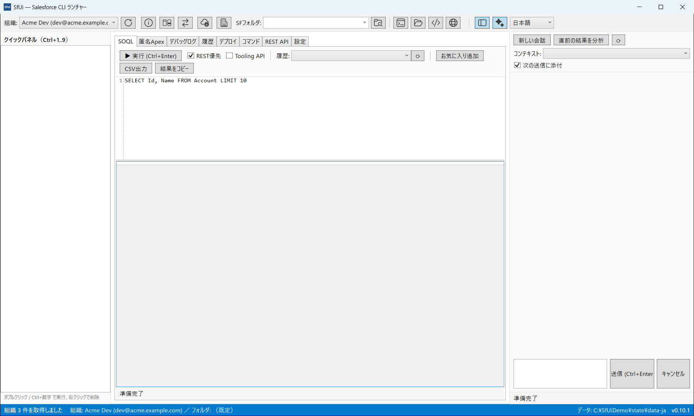
*SOQL ワークスペース — 左: クイックパネル / 右: AI チャット / 上部: アイコン ツールバーと組織・フォルダ切替*

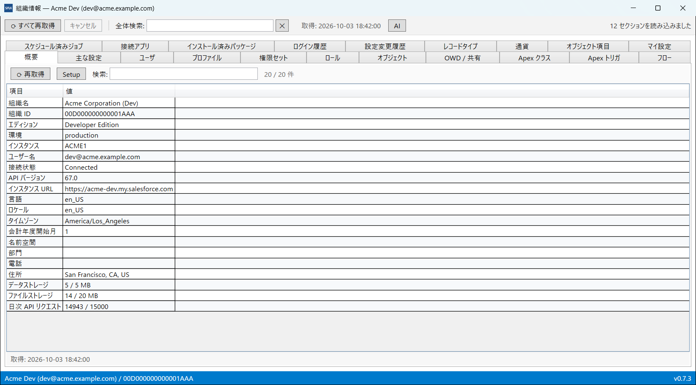
*組織情報 — 組織ごとの別ウィンドウ。20 以上のタブ・全タブ横断検索・Setup リンク・専用 AI パネル*

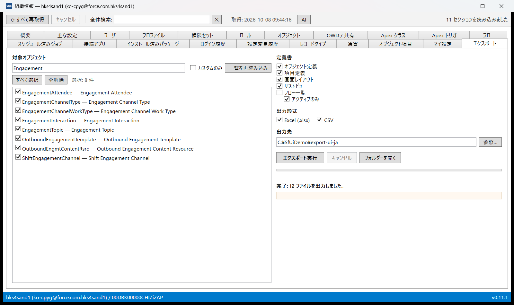
*組織情報 → エクスポート — オブジェクトと定義書（オブジェクト / 項目 / 画面レイアウト / リストビュー / フロー）を選んで、複数シートの Excel ブックとシートごとの CSV を書き出します*

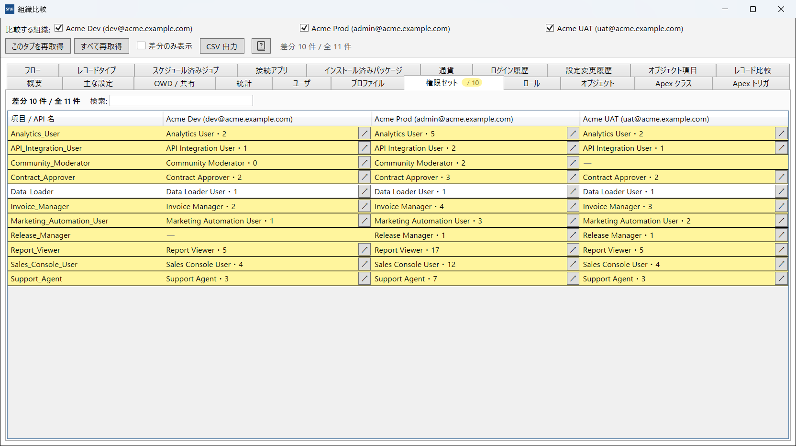
*組織比較 — 最大 8 組織を横並び比較。「片方にのみ存在」「値が異なる」行を黄色でハイライト*


*組織比較 → レコード比較タブ — オブジェクト・照合キー・比較項目を選び、各組織を REST SOQL で取得してキーで突合（画面は英語 UI）*


*レコード差分詳細 — 行をダブルクリックすると 1 レコード分の項目別差分を表示（画面は英語 UI）*

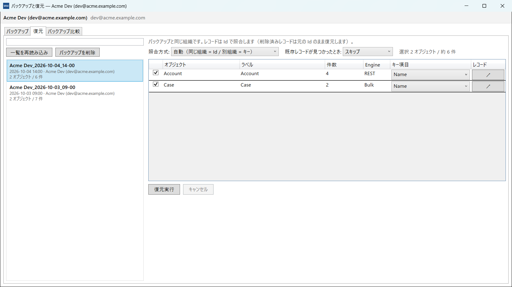
*バックアップと復元 — バックアップを選んで Id / キー照合で復元。ラベル・説明・組織情報・件数は自動で入力されます*

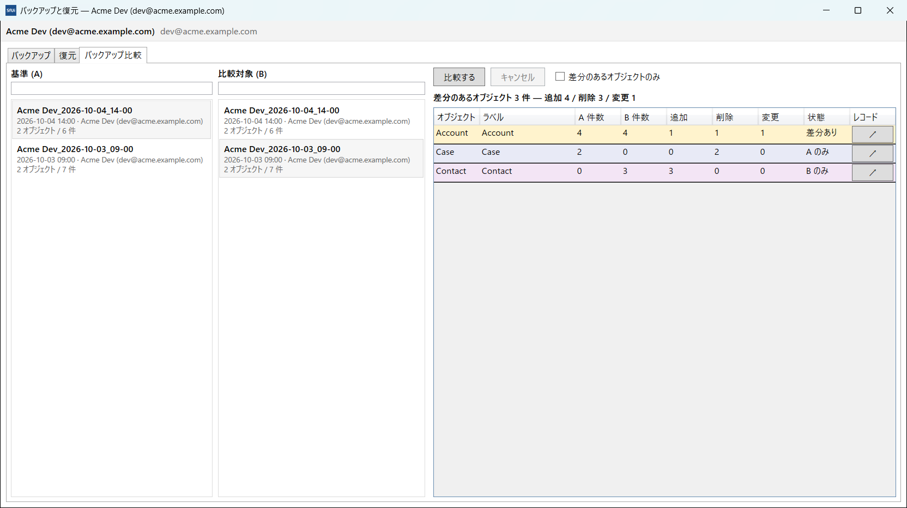
*バックアップ比較 — 差分のあるオブジェクトを色でハイライト（差分 / A のみ / B のみ）。レコード単位の差分は別ウィンドウで表示*

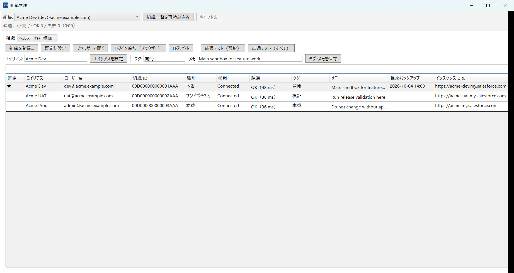
*組織管理 — 認証済み組織の一覧。ローカルのタグ・メモ、疎通テスト、最終バックアップ、既定 / エイリアス / ログイン / ログアウトをワンクリック*

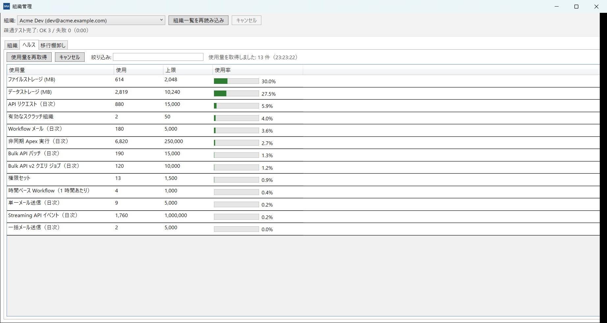
*ヘルス — REST の使用量をバー付きで表示（80% 以上は赤）。使用率順 + 名前で絞り込み*

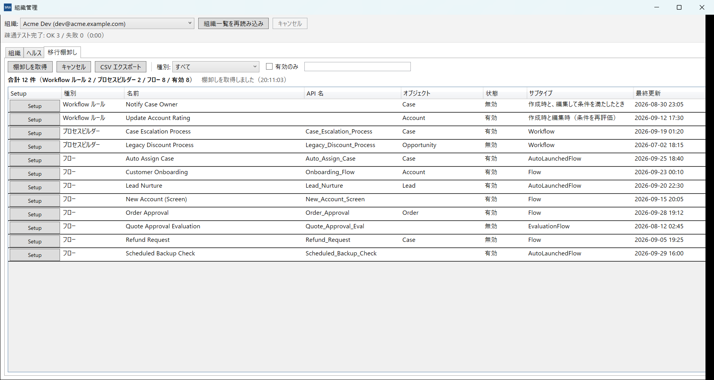
*移行棚卸し — Workflow ルール（有効 / 無効は Metadata から取得）/ プロセスビルダー / フローを種別・有効状態で絞り込み、CSV 出力と Setup リンク付き*

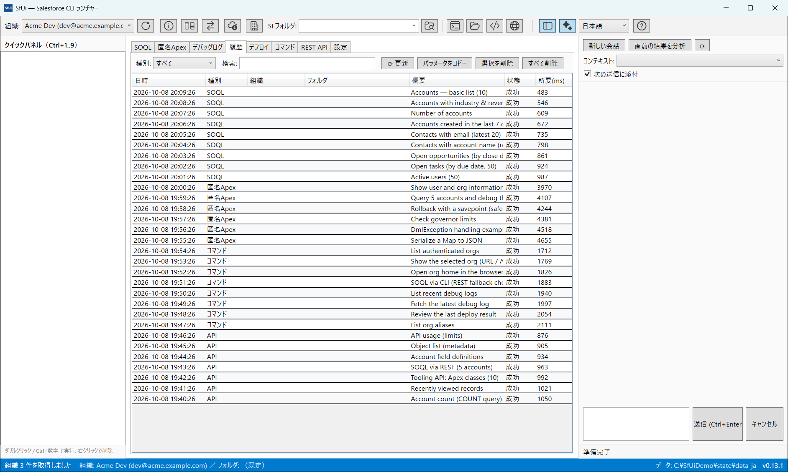
*すべての操作を履歴に保存し、ダブルクリックで再実行*

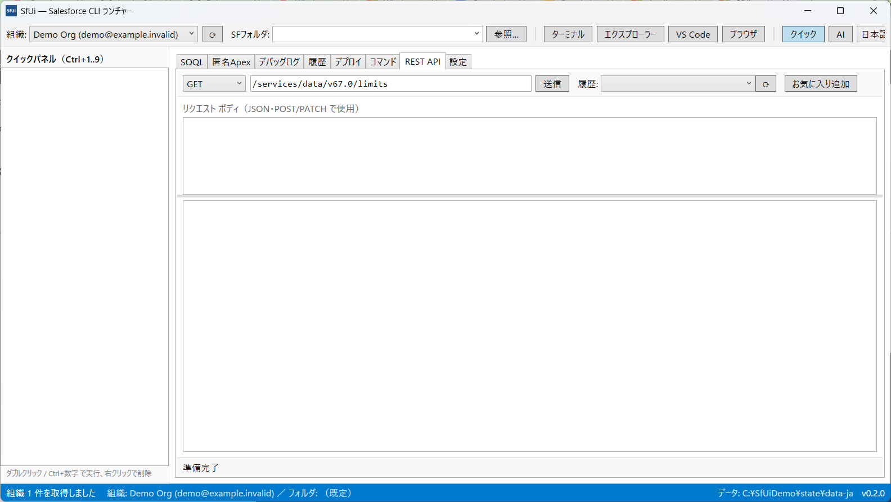
*汎用 REST コンソール（JSON 整形表示）*

## 設定・データの保存場所

データ ルートは次の順で決まります: 1) `--data-dir <パス>` / 環境変数 `SFUI_DATA_DIR`、2) ソースから実行時のソリューションルートの `data/`、3) exe の隣のポータブル `data/`（書き込み可能な場合）、4) 書き込み不可なら `%APPDATA%\SfUi`。

```
data\
├─ settings.json            設定（言語 / sf パス / AI / 履歴上限 / 確認ポリシー / backupRestMaxRecords など）
├─ favorites.json           お気に入り（クイックパネル）
├─ recent-folders.json      最近使ったフォルダ
├─ recent-urls.json         最近開いた URL
├─ history\                 実行履歴（種別ごと: soql.json / apex.json / api.json / data.json …）
├─ results\                 大きい実行結果の保存（履歴エントリ単位の .txt / .json）
├─ logs\app-yyyyMMdd.log    アプリの実行ログ
├─ tmp\                     一時ファイル
├─ orginfo\                 組織情報ウィンドウのキャッシュ
│   ├─ <組織キー>.json      組織ごとのタブ データ
│   ├─ preferences.json     タブ表示設定
│   └─ compare.json         組織比較の状態
├─ backup-state.json        バックアップタブの選択オブジェクト記憶（組織別）
└─ backups\
    ├─ counts.json          オブジェクト件数キャッシュ
    └─ <yyyyMMdd-HHmmss>\   バックアップ本体
        ├─ metadata.json    ラベル・説明・組織情報・オブジェクト一覧
        └─ <Object>.json / <Object>.csv   REST / Bulk の保存データ
```

JSON はすべて原子的書き込み（`AtomicJsonFile`: 一時ファイル → `File.Replace`）で、破損時に備えて `*.bak` を残します。`data/` フォルダごとコピーすれば設定・履歴・バックアップも一緒に移せます。

## 前提条件

- Windows 10 / 11（x64）、または macOS 11 以降（Apple Silicon）
- **Salesforce CLI（`sf`）** がインストール済みで、いずれかの組織にログイン済みであること
  - 既定のパスは `C:\Program Files\sf\bin\sf.cmd`（Windows。設定画面または環境変数 `SFUI_SF_PATH` で変更可）
- 単一 EXE 版の実行に .NET ランタイムは不要（自己完結）

## 主なショートカット

- `Ctrl+Enter` … SOQL / 匿名Apex を実行
- `Enter` … コマンド実行
- `Ctrl+1..9` … クイックパネルのお気に入りを実行
- `F5` … 直前の操作を再実行

## 免責事項

本ツールは **Salesforce, Inc. とは無関係の非公式ツールです**（非提携・非承認・非スポンサー）。Salesforce は Salesforce, Inc. の商標です。

## ライセンス

**MIT**（[LICENSE](LICENSE) 参照）。商用を含め、使用・改変・再配布は自由です（著作権表示の維持のみ必要）。同梱のサードパーティ製コンポーネント（Avalonia / AvaloniaEdit / CommunityToolkit.Mvvm / Microsoft Fluent UI アイコン等）は、それぞれのライセンス（主に MIT）に従います。
